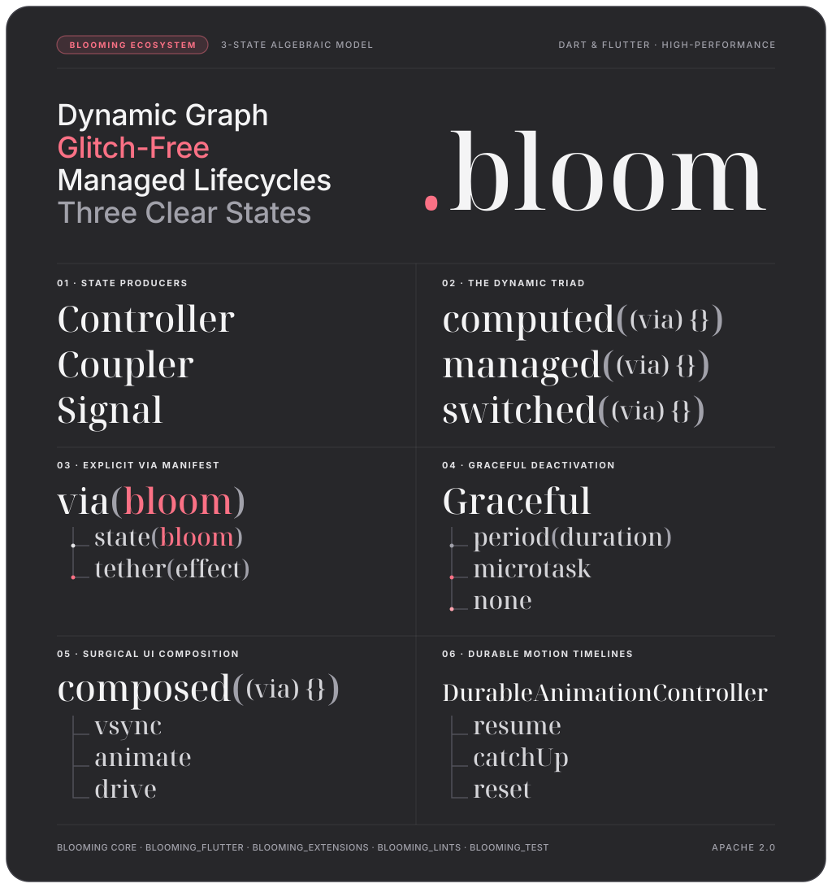
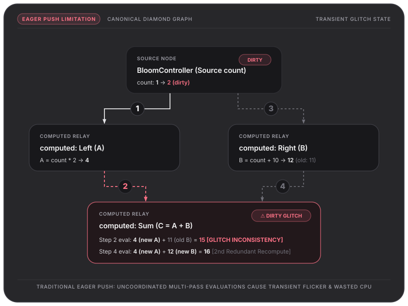
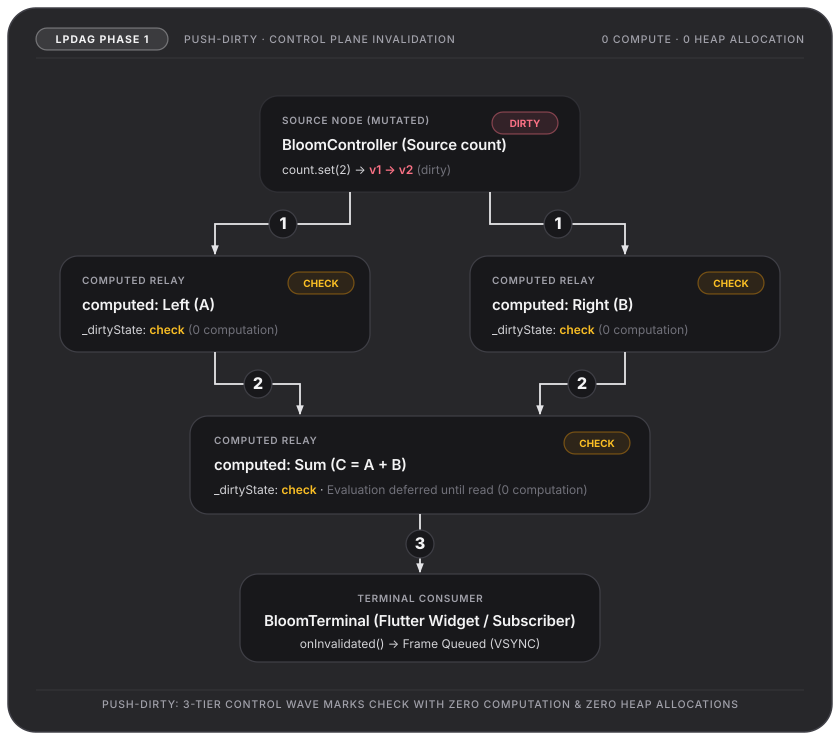
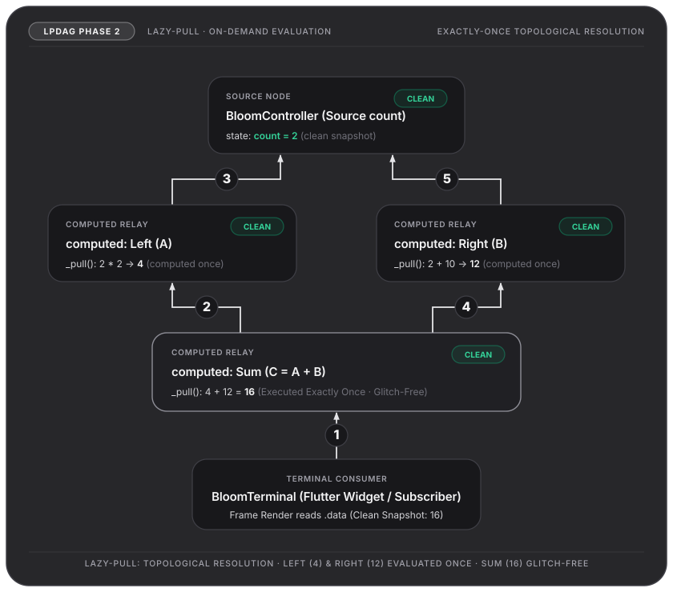

<p align="center">
  
</p>

# Blooming

**A lazy, glitch-free reactive state engine for Dart and Flutter.**

[](https://pub.dev/packages/blooming)
[](https://pub.dev/packages/blooming_flutter)
[](LICENSE)
[](https://flutter.dev)
[](https://dart.dev)
<!-- TODO: add CI and coverage badges once a workflow is published -->

Blooming separates *telling the graph that something changed* from *recomputing nodes that depend on it*.
A mutation only marks downstream nodes dirty. Values are computed later, on demand, in dependency
order, so a node in a diamond-shaped graph is evaluated once per change and never observes a
half-updated state.

It is inspired by modern two-phase signal designs ([Preact Signals](https://github.com/preactjs/signals),
[alien-signals](https://github.com/stackblitz/alien-signals)) and Flutter's own `RenderObject` pipeline,
and adds first-class lifecycle management (dormancy, graceful retention, managed resources) and
Flutter bindings that rebuild only the widget that actually reads a changed value.

> **Status: pre-1.0.** The API can change between minor versions. See the
> [upgrade notes](#upgrade-notes) and each package's `CHANGELOG.md` before bumping.

---

## Packages

| Package | Description |
| --- | --- |
| [`blooming`](packages/blooming) | Pure Dart core: `BloomController`, `computed`, `switched`, `managed`, effects, SWR snapshots, graceful lifecycle. |
| [`blooming_flutter`](packages/blooming_flutter) | Flutter bindings: `bloom.build`, `bloom.listen`, `composed`, `BloomWidget`, `BloomListener`, scoped state, durable animations. |
| [`blooming_extensions`](packages/blooming_extensions) | Reactive extensions for collections, iterables, async pipelines and diffing. |
| [`blooming_lints`](packages/blooming_lints) | Lint rules that catch common mistakes (untracked reads, escaping `via`, creating nodes in `build`, …). |
| [`blooming_test`](packages/blooming_test) | Test harness and matchers for pure Dart reactive state. |
| [`blooming_flutter_test`](packages/blooming_flutter_test) | Widget-test harness and node mocking for Bloom. |

---

## Why Bloom?

### 1. The problem: eager push produces glitches

In an eager push system (plain `Stream`/Rx chains, or naive observers), a change is pushed to every
dependent immediately. In a **diamond** graph, a node can be computed from one fresh input and one
stale input.



When `Root` changes from `1` to `2`:

1. `Root` pushes `2` to `Left (A)`, which computes `4` and pushes it to `Sum (C)`.
2. `Sum (C)` evaluates `4 + 11 (old B) = 15`. **Transient inconsistent state.**
3. `Root` pushes `2` to `Right (B)`, which computes `12`.
4. `Sum (C)` evaluates again: `4 + 12 = 16`.

The consequences are flicker, wasted work, and side effects (network calls, navigation) fired from
values that were never valid together.

### 2. The approach: two-phase propagation



**Phase 1 — Push-Dirty.** When a source changes, its version is bumped and a dirty mark travels
downstream along intrusive edge links. Nodes that are already dirty are skipped. No user
computation runs and no derived value is recomputed; terminals (effects, widget elements) are only
queued for the scheduler. The work is proportional to the affected part of the graph, not to the
whole graph.



**Phase 2 — Lazy Pull.** When something reads a value (a widget during build, an effect, or `untracked(node)`),
a clean active node returns its cached snapshot. A dirty node first pulls its dependencies in
topological order, so `Left` and `Right` are both up to date before `Sum` runs once and produces `16`.

### 3. Where Blooming differs from other signal libraries

Glitch-free propagation is not unique to Bloom. Preact Signals, alien-signals and signals.dart all
provide it. Blooming's focus is on the parts around the core:

- **Subscriber-driven dormancy.** A node with no subscribers detaches from its sources and goes dormant.
- **Graceful retention.** `Graceful.period(...)` / `Graceful.microtask` keep a node and its in-flight
  work alive across short unsubscribe gaps such as tab or route switches.
- **`managed`.** Synchronous external resources (`create`, `update`, `dispose`) tied to the node lifecycle.
- **Three-state snapshots.** `Data` / `Empty` / `Error`, with stale-while-revalidate semantics.
- **Explicit dependency tracking.** `via(node)` instead of ambient tracking, so there is no hidden
  global tracking context. The trade-off is that you must read through `via` inside `computed`
  (the lints in `blooming_lints` help enforce this).
- **Durable animations.** `DurableAnimationController` with `resume`, `catchUp` and `reset` policies
  across dormancy.

---

## Quick start

### Pure Dart

```yaml
dependencies:
  blooming: ^0.1.0
```

```dart
import 'package:blooming/effect.dart';
import 'package:blooming/blooming.dart';

Future<void> main() async {
  final count = BloomController(0);

  // `via(...)` declares which nodes this computation depends on.
  final doubled = computed((via) => via(count.bloom) * 2);

  print(untracked(doubled)); // 0

  count.set(5);
  print(untracked(doubled)); // 10 (evaluated lazily, on read)

  // Effects are terminals: they run after the microtask flush, not inside the mutation.
  final runner = doubled.effect(() => print('doubled is now ${untracked(doubled)}')).run();

  count.set(6);
  await Future<void>.delayed(Duration.zero);

  runner.deactivate(); // detaches from the graph
}
```

Three things to know:

- `BloomController` is the writable source. `.bloom` is the read-only node view of it.
- `via(node)` reads a node **and registers it as a dependency**. `untracked(node)` reads without registering.
- `computed` is lazy: nothing is evaluated until something reads it.

### Flutter

```yaml
dependencies:
  flutter:
    sdk: flutter
  blooming_flutter: ^0.1.0
  # blooming: ^0.1.0 # optional: blooming_flutter re-exports blooming
```

```dart
import 'package:flutter/material.dart';
import 'package:blooming_flutter/blooming_flutter.dart';

final counter = BloomController(0);
int pageBuilds = 0; // demo only: counts rebuilds of CounterPage

void main() => runApp(const MaterialApp(home: CounterPage()));

class CounterPage extends StatelessWidget {
  const CounterPage({super.key});

  @override
  Widget build(BuildContext context) {
    pageBuilds++;
    return Scaffold(
      appBar: AppBar(title: const Text('Blooming counter')),
      body: Center(
        child: Column(
          mainAxisAlignment: MainAxisAlignment.center,
          children: [
            // Stays at "1" when the counter changes: this build method does not re-run.
            Text('CounterPage built $pageBuilds time(s)'),
            // 1. Direct 1:1 node binding (zero-allocation extension):
            counter.bloom.build((context, count) => Text(
                  'Count: $count',
                  style: const TextStyle(fontSize: 32),
                )),
            // 2. Or dynamic multi-node tracking with `composed`:
            // composed((context, via) => Text('Count: ${via(counter.bloom)}')),
          ],
        ),
      ),
      floatingActionButton: FloatingActionButton(
        onPressed: () => counter.set(counter.data + 1),
        child: const Icon(Icons.add),
      ),
    );
  }
}
```

Two complementary ways to bind UI:

- **`bloom.build((context, data) => ...)`**: Zero-allocation compile-time functor (`extension type const`) bound 1:1 to a single node. Supports `.build.child(...)` and `.build.children(...)` (use `BloomAsyncBuilder` for 4-state asynchronous branching).
- **`composed((context, via) => ...)`**: Dynamic dependency discovery tracking multiple nodes through `via(...)`.

When `counter` changes, only that leaf element rebuilds while the surrounding `CounterPage` is left alone. Note that if a *parent* rebuilds for another reason, the leaf element re-runs its builder like any other widget.

### Side effects without rebuilding

```dart
// Fluent extension syntax (recommended):
counter.bloom.listen(
  (context, value) {
    if (value == 10) {
      ScaffoldMessenger.of(context).showSnackBar(
        const SnackBar(content: Text('Reached 10')),
      );
    }
  },
  child: const SizedBox.shrink(),
);

// Declarative widget syntax: BloomListener(counter.bloom, (context, value) { ... })
```

`bloom.listen` (and `BloomListener`) never rebuilds its child, does not fire on mount, and runs the
action after the microtask flush, outside Flutter's build phase. Rate-limiting is available via
`bloom.listen.debounce(...)` or `bloom.listen.throttle(...)`.

---

## Comparison

A qualitative summary, not a benchmark. Details change between releases (checked October 2026),
so confirm against each project's documentation.

| | **Blooming** | **Riverpod 3** | **signals.dart** |
| --- | --- | --- | --- |
| Core model | Lazy-pull dependency graph, two-phase invalidation | Provider graph with caching and DI | Dart port of Preact Signals, fine-grained and lazy |
| Dependency tracking | Explicit `via(node)` | `ref.watch` | Automatic on read |
| Async | `computed.future` / `computed.stream`, SWR snapshots | `AsyncValue`, automatic retry, experimental mutations/offline | `AsyncSignal` / `StreamSignal` |
| Scoped state / DI | `provide` / `bloomOf` | Overrides, scoping, families | Not a DI framework |
| Lifecycle | Subscriber-driven dormancy, graceful retention, `managed` | Auto-dispose, keep-alive, pause/resume | Dispose and auto-dispose helpers |
| Tooling | Lints, test harnesses | Generator, lints, large ecosystem | Lints, hooks, devtools extension |
| Maturity | Pre-1.0, single maintainer | Stable 3.x, large community | Multi-package, active releases |

**When to choose Blooming**

- Choose **Riverpod** for app-wide architecture, dependency injection and testability with the largest ecosystem.
- Choose **signals.dart** for a small, familiar fine-grained signals API.
- Consider **Blooming** if lifecycle behavior (retention across route/tab switches, managed resources,
  drift-compensated animations) is central to your app, and you accept a pre-1.0 API.

---

## Benchmarks

A comparative NASDAQ order-book benchmark run and its limitations are documented in
[`benchmark/nasdaq_order_book/ASSESSMENT.md`](benchmark/nasdaq_order_book/ASSESSMENT.md). The current
run measures event-loop responsiveness under a capped batched workload; it does not establish
actual billion-TPS throughput or prove data correctness. A micro-benchmark also lives in
[`packages/blooming/benchmark/million_ticks_benchmark.dart`](packages/blooming/benchmark/million_ticks_benchmark.dart).

---

## Upgrade notes

**`BloomListener` (blooming_flutter)**

`BloomListener<T>` observes a single target and forwards its typed state directly to `action`.
To observe multiple nodes, compose them into a derived node via `computed` in controller or store scope.
The `take` parameter is supported across `BloomListener`, `BloomListener.debounce`,
`BloomListener.throttle`, and `bloom.listen` for autonomous early teardown once an execution quota
is exhausted (e.g., `take: 1` for one-shot navigation, dialogs, or banners).

```dart
// 1. Compose multi-node conditions in controller/store scope (outside build):
final checkout = computed((via) => (
  user: via(authController.bloom),
  count: via(cartController.bloom).length,
));

// 2. Direct functor syntax with one-shot execution bounding (take: 1):
checkout.listen(
  (context, state) => showCheckoutBanner(context, state.user, state.count),
  take: 1, // Automatically severs dependency edges after executing once
);

// Or declarative widget syntax:
BloomListener(
  checkout,
  (context, state) => showCheckoutBanner(context, state.user, state.count),
  take: 1,
);
```

---

## Documentation

- [LPDAG whitepaper](packages/blooming/doc/LPDAG.md) — specification of the push-dirty / lazy-pull engine
- [Flutter foundations](packages/blooming_flutter/doc/foundations/README.md) — composed functors, durable animations, lifecycle
- [`packages/blooming/example`](packages/blooming/example) and [`packages/blooming_flutter/example`](packages/blooming_flutter/example) — runnable examples
- Changelogs: [`blooming`](packages/blooming/CHANGELOG.md), [`blooming_flutter`](packages/blooming_flutter/CHANGELOG.md), [`blooming_extensions`](packages/blooming_extensions/CHANGELOG.md), [`blooming_lints`](packages/blooming_lints/CHANGELOG.md), [`blooming_test`](packages/blooming_test/CHANGELOG.md), [`blooming_flutter_test`](packages/blooming_flutter_test/CHANGELOG.md)

## Contributing

Issues and pull requests are welcome at the [issue tracker](https://github.com/pioneerjkf/blooming/issues).
Please run `dart analyze` and the package tests before opening a PR.
<!-- TODO: add CONTRIBUTING.md and SECURITY.md and link them here -->

## Maintainer

Maintained by [pioneerjkf.dev](https://pub.dev/publishers/pioneerjkf.dev).
Questions or security reports: <pioneer.jkf@gmail.com>.

## License

Apache License 2.0. See [LICENSE](LICENSE).
